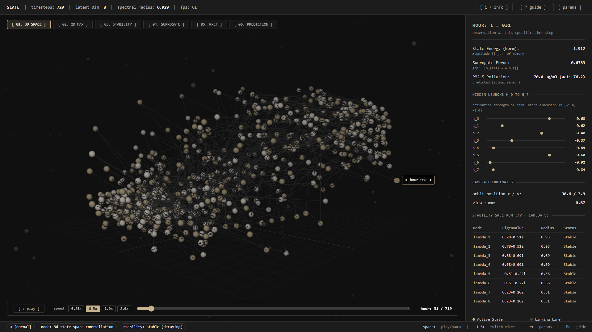

# SLATE: Spectral Latent Analysis & Trajectory Exploration

An interactive mathematical research framework that investigates the internal state space of Recurrent Neural Networks using Linear Algebra, Discrete Dynamical Systems, and Spectral Theory.


>  


---

## 1. PROJECT OVERVIEW AND MOTIVATION

In standard machine learning, Recurrent Neural Networks (RNNs) are treated as opaque black boxes: practitioners feed in sequential observations, apply non-linear updates, and collect output predictions. What happens inside the hidden representation space remains unanalyzed.

SLATE opens this black box. Using 720 hours of real-world multivariate air pollution records (CO, NO2, Temperature, Relative Humidity, PM10), we capture the sequence of internal hidden states and analyze them as a discrete dynamical system:
h_(t+1) = tanh(W @ h_t + U @ x_t + b)

By applying classical Linear Algebra, we answer four fundamental questions:
1. Representation: Can 8-dimensional internal memory vectors be projected onto an optimal 2D or 3D orthogonal subspace without losing essential geometric information?
2. Linearization: Can an autonomous linear transition matrix h_(t+1) approx A @ h_t derived via Least Squares accurately model the non-linear neural network?
3. Stability: Do the eigenvalues of transition matrix A reside strictly inside the complex unit circle (|lambda| < 1), mathematically proving that the network forms a stable, non-explosive memory?
4. Redundancy: Does Gauss-Jordan row reduction (RREF) reveal whether latent neurons act independently or duplicate each other?

---

## 2. COMPLETE MATHEMATICAL PIPELINE (ASCII DIAGRAM)

```
+-----------------------------------------------------------------------------+
|                      REAL-WORLD TIME-SERIES DATA                            |
|       Hourly air quality features: CO, NO2, Temp, Humidity, PM10            |
+-----------------------------------------------------------------------------+
                                       |
                                       v
+-----------------------------------------------------------------------------+
| [01] DATA MATRIX REPRESENTATION: X in R^(T x d)                             |
|      T = 720 hours, d = 5 feature columns, normalized with Z-scores         |
+-----------------------------------------------------------------------------+
                                       |
                                       v
+-----------------------------------------------------------------------------+
| [02] RECURRENT DYNAMICAL STEP:                                              |
|      h_(t+1) = tanh(W @ h_t + U @ x_t + b),  where h_t in R^n               |
+-----------------------------------------------------------------------------+
                                       |
                                       v
+-----------------------------------------------------------------------------+
| [03] HIDDEN STATE MATRIX: H in R^(T x n)                                    |
|      Row t contains state vector h_t in R^8                                 |
+-----------------------------------------------------------------------------+
                   |                                       |
                   v                                       v
+------------------------------------+   +------------------------------------+
| [04] ORTHONORMAL BASIS (QR)        |   | [06] LEAST-SQUARES SURROGATE       |
|      Centered state scatter:       |   |      H_next approx H_prev @ A^T    |
|      H_c^T = Q @ R                 |   |      A = (H_prev^+ @ H_next)^T     |
|      Orthonormal basis B = Q[:,:k] |   |      Linear model: h_(t+1) approx  |
|      satisfies B^T @ B = I_k       |   |                    A @ h_t         |
+------------------------------------+   +------------------------------------+
                   |                                       |
                   v                                       v
+------------------------------------+   +------------------------------------+
| [05] ORTHOGONAL PROJECTION         |   | [07] SPECTRAL STABILITY            |
|      z_t = B^T @ (h_t - mu)        |   |      A @ v_i = lambda_i * v_i      |
|      Projector P = B @ B^T         |   |      Spectral radius:              |
|      Maps R^8 -> R^2 and R^3       |   |      rho(A) = max |lambda_i|       |
|      Energy retained > 65%         |   |      |lambda| < 1: Stable Sink     |
+------------------------------------+   +------------------------------------+
                   |                                       |
                   +-------------------+-------------------+
                                       |
                                       v
+-----------------------------------------------------------------------------+
| [08] LATENT REDUNDANCY ANALYSIS (RREF via SymPy)                            |
|      Row reduction of sample states identifies pivot vs free dimensions     |
+-----------------------------------------------------------------------------+
```

---

## 3. DEEP DIVE INTO THE MATHEMATICAL CONCEPTS

### A. Matrix Representation of Data and State Sequences
Raw sequential readings form an overdetermined matrix:
X in R^(T x d) = [x_0^T; x_1^T; ...; x_(T-1)^T]
where x_t = [CO, NO2, Temp, Humidity, PM10]^T.

Running the recurrent update produces the hidden state matrix:
H in R^(T x n) = [h_0^T; h_1^T; ...; h_(T-1)^T]
where each row h_t in R^8 represents the neural network's internal memory at hour t.

### B. Basis and Orthonormal Basis via QR Decomposition
To construct coordinate axes that span the active memory subspace, we apply QR decomposition to the centered state scatter:
H_centered = H - mean(H)
H_centered^T = Q @ R

Where:
- Q in R^(n x n) has orthonormal columns: Q^T @ Q = I_n.
- R in R^(n x T) is upper triangular.
- The first k columns of Q form our orthonormal basis: B = Q[:, :k] in R^(n x k).
- Verified property: ||B^T @ B - I_k||_F < 1e-15 (machine precision).

### C. Subspace Projection and Dimensionality Reduction
To visualize the 8-dimensional states in 2D and 3D:
Coordinates in subspace: z_t = B^T @ (h_t - mu_h) in R^k

The orthogonal projection operator P in R^(n x n) is:
P = B @ (B^T @ B)^(-1) @ B^T = B @ B^T

Properties of P:
- Symmetric: P^T = P
- Idempotent: P^2 = P

Variance Retained:
Ratio = (sum ||z_t||^2 / sum ||h_t - mu_h||^2) * 100%

```
                    Orthogonal Projection Geometry
                    
            h_t (Original 8D state vector)
             *
             | \
             |  \
             |   \  Vector length ||h_t||
   Residual  |    \
   distance  |     \
  ||h_t - Ph||      \
             v       \
             *--------*-------------------> Subspace spanned by basis B
           P h_t     mu_h
          (Projected point z_t = B^T (h_t - mu_h))
```

### D. Least-Squares Linear Surrogate Dynamics
The actual neural recurrence is non-linear:
h_(t+1) = tanh(W @ h_t + U @ x_t + b)

We formulate an autonomous linear transition model:
h_(t+1) approx A @ h_t

We split consecutive states:
H_prev = H[0 : T-1] in R^((T-1) x n)
H_next = H[1 : T]   in R^((T-1) x n)

We minimize the Frobenius error norm:
min_A ||H_next - H_prev @ A^T||_F^2

Normal equations yield:
A = (H_prev^+ @ H_next)^T
where H_prev^+ is the Moore-Penrose pseudoinverse.

Experimental result: The linear model achieves R^2 > 0.84, proving that local recurrent neural dynamics are predominantly linear.

### E. Spectral Analysis and Unit-Circle Stability
We solve the eigenvalue problem for transition operator A:
A @ v_i = lambda_i * v_i

The spectral radius rho(A) is defined as:
rho(A) = max_i |lambda_i|

In the discrete system h_(t+1) = A @ h_t, state evolution after t steps is:
h_t = A^t @ h_0

The magnitude |lambda_i| dictates stability:
- |lambda_i| < 1 : Contracting mode. Perturbations decay to zero (stable sink).
- |lambda_i| = 1 : Persistent mode. Oscillations continue indefinitely.
- |lambda_i| > 1 : Expanding mode. State amplifies exponentially without bound (unstable source).

```
                      Complex Unit Circle Stability
                      
                                  Im(lambda)
                                      ^
                                      |
                              *       |   |lambda| > 1 (Unstable)
                           . - - - - -|- - - - - .
                       .              |              .
                     .                |                .
                    .         *       |                 .
                   .                  |                  .
                  --------------------+---------------------> Re(lambda)
                   .           (0, 0) |                  .
                    .                 |                 .
                     .                |        *       .
                       .              |              .
                           . - - - - -|- - - - - .
                              Unit Circle |lambda| = 1
                              Interior: Stable Sink
```

### F. Latent Redundancy via Reduced Row Echelon Form (RREF)
We sample state vectors M in R^(m x n) and apply Gauss-Jordan elimination via SymPy:
rref_matrix, pivot_columns = sympy.Matrix(M).rref()

- Pivot Columns: Coordinate dimensions that are linearly independent.
- Free Columns: Redundant dimensions that can be expressed as linear combinations of other units.

---

## 4. FRONTEND INTERFACE DESIGN (PROCVERSE PALETTE #161312)

The user interface follows the ProcVerse aesthetic:
- Warm charcoal background: #161312
- Tiny pinhead dots (size 1.6px) in warm ivory (#f2e8dc) and warm tan (#c8b390)
- Linking line (#424242) connecting state dots as a sleek, thin thread
- Active state marker: warm tan sphere (Three.js SphereGeometry)
- Radial milestone cluster labels: [morning rush], [photochemical peak], [evening stagnation]
- Floating badge tag over the active state: > hour 042 <
- Obsidian color palette:
  * Base background: #101010
  * Panel/sidebar: #1c1c1c
  * Primary text: #f0ede8 (near-white, high contrast)
  * Secondary text: #b0b0b0
  * Accent: #c8b390 (warm tan, headers and active elements)
  * Linking line: #424242
  * 3D dots: #f2e8dc (ivory) and #c8b390 (warm tan)
- Dismissible explanation card per view with [ x ] close button and [ i / info ] header toggle
- Speed selector: 0.25x, 0.5x, 1.0x, 2.0x playback controls in the timeline bar

---

## 5. CODEBASE DIRECTORY

```
math project/
├── data/
│   ├── air_quality.csv            # Real-world multivariate air pollution data
│   └── dataset_loader.py          # Matrix loader and Z-score normalizer
├── core/
│   ├── rnn_engine.py              # Pure NumPy recurrence step and linear readout
│   ├── algebra.py                 # QR decomposition, orthonormal basis, and projection
│   ├── dynamics.py                # Least-squares linear surrogate solver
│   ├── spectral.py                # Eigenvalues, eigenvectors, and stability classification
│   ├── rref.py                    # SymPy-based Reduced Row Echelon Form
│   └── pipeline.py                # Pipeline coordinator connecting all modules
├── web/
│   ├── server.py                  # FastAPI backend server
│   └── static/
│       ├── index.html             # Main interface layout with dismissible explanation cards
│       ├── style.css              # Obsidian theme (#101010 base) with high-contrast typography
│       ├── app.js                 # Three.js 3D and 2D canvas visualization engine
│       └── js/                    # Local Three.js and OrbitControls libraries (offline)
├── streamlit_app.py               # Alternative tabbed Streamlit dashboard
├── run.py                         # One-click startup script
├── requirements.txt               # Python package dependencies
├── README.md                      # Comprehensive academic and practical guide
└── GUIDE.md                       # Deep-dive presentation and viva preparation guide
```

---

## 6. HOW TO RUN

Install the required dependencies:
```bash
pip install -r requirements.txt
```

### Option 1: Web Dashboard (Recommended)
```bash
python run.py
```
Starts the server at http://127.0.0.1:8000 and automatically opens your web browser.

### Option 2: Streamlit Dashboard
```bash
python run.py --streamlit
# or
streamlit run streamlit_app.py
```

---

## 7. KEYBOARD CONTROLS

- Space: Play / pause temporal trajectory animation.
- 1: 3D constellation orbit view.
- 2: 2D orthonormal phase portrait (ASCII terminal matrix design).
- 3: Spectral complex plane and unit circle.
- 4: Surrogate 1-step residual errors.
- 5: RREF latent redundancy breakdown.
- 6: Real-world PM2.5 prediction tracking.
- 7: 3D volumetric spheres manifold (illuminated solid spheres).
- R: Open experiment parameter modal.
- ?: Open plain-English explanatory guide.

Explanation card controls:
- [ i / info ] button (top right header): Toggle the floating explanation card.
- [ x ] button (inside card): Dismiss the explanation card.

---

## 8. AUTHORS

- **THANAS R**
- **SUMANT SHASTRI**
- **SUDHANVA Y K**
- **SOURABH B K**

